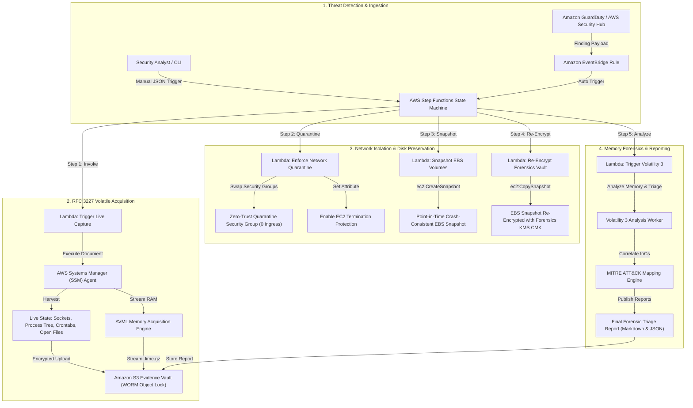
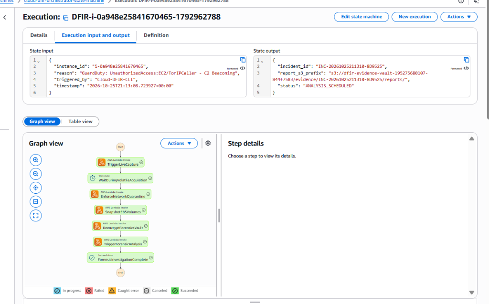
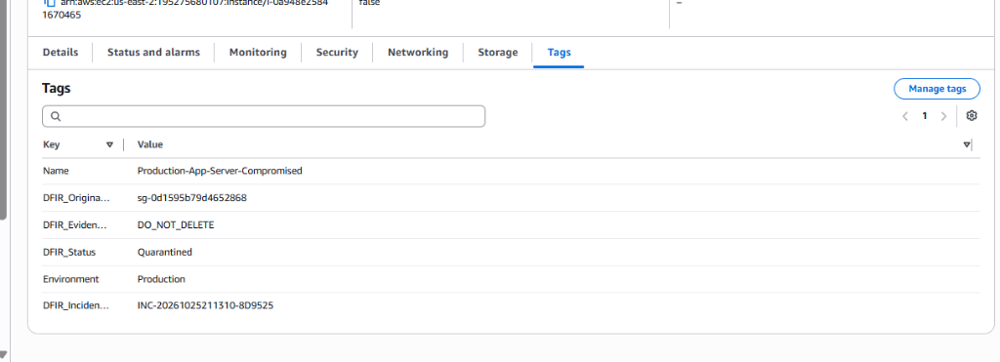
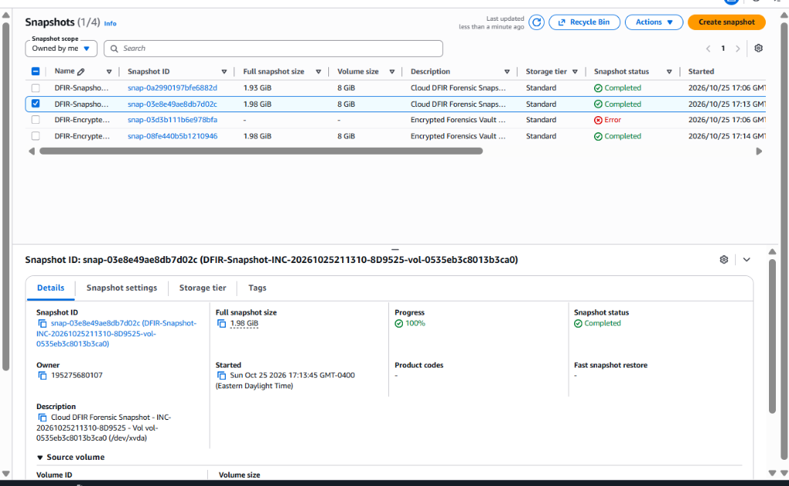

# AWS Cloud DFIR - Autonomous Cloud Digital Forensics and Incident Response Orchestrator

AWS Cloud DFIR is an enterprise-grade digital forensics and incident response automation engine designed for Amazon Web Services environments. The platform autonomously captures volatile runtime artifacts, streams physical memory (RAM) directly to an immutable evidence vault, isolates compromised EC2 instances using zero-trust network quarantine, creates crash-consistent disk snapshots re-encrypted under a dedicated forensics Key Management Service (KMS) Customer Managed Key (CMK), and processes memory dumps through Volatility 3 to map indicators of compromise to the MITRE ATT&CK framework. The engine operates in strict compliance with RFC 3227 standards for evidence volatility, ensuring that memory and transient network states are preserved prior to host modification or disk snapshotting.

---

## Key Features

* RFC 3227 Order of Volatility Enforcement: Acquires volatile system telemetry and physical memory before modifying instance network settings or snapshotting disks, preventing evidence destruction.
* Direct Memory Streaming Without Disk Stomping: Executes statically linked Microsoft AVML (Acquire Volatile Memory for Linux) via AWS Systems Manager to compress and stream physical RAM directly to Amazon S3 without writing intermediate dump files to the target disk.
* Zero-Trust Network Quarantine: Replaces instance security groups dynamically with an isolation group that revokes all inbound traffic and limits outbound traffic strictly to AWS Systems Manager endpoints over port 443, preserving command-and-control visibility while stopping lateral movement and data exfiltration.
* Tamper-Proof S3 Evidence Vault (WORM Compliance): Stores forensic archives, memory dumps, and execution logs in an S3 bucket configured with Object Lock in Compliance mode, preventing deletion or modification even by root account credentials.
* Dedicated Forensics KMS CMK Re-Encryption: Re-encrypts all EBS volume snapshots under an isolated Customer Managed Key with restricted key policies, ensuring compromised workload roles cannot decrypt, manipulate, or delete disk evidence.
* Automated Volatility 3 Analysis Engine: Integrates automated memory inspection routines (including process listing, malfind code injection detection, and socket analysis) mapped directly to MITRE ATT&CK techniques with Markdown and JSON report outputs.
* Native EventBridge Detection Hook: Connects natively to Amazon GuardDuty and AWS Security Hub to initiate automated containment and triage immediately upon high-severity alert generation.

---

## System Architecture



<p align="center"><b>Figure 1: RFC 3227 Autonomous Cloud Forensics & Incident Response Architecture</b></p>

### Architecture Flow Explanation

1. Ingestion Phase: An incident is initiated either automatically through Amazon EventBridge when Amazon GuardDuty or AWS Security Hub emits a high-severity finding (severity 7.0 to 8.9), or manually by an incident responder invoking the Step Functions state machine with a target instance identifier.
2. Live Volatile State Collection: The state machine executes the initial AWS Lambda function, which dispatches the `CloudDFIR-LiveVolatileAcquisition` AWS Systems Manager document to the target instance. The script collects active listening sockets, established connections, running process hierarchies, kernel modules, logged-in sessions, and scheduled tasks. The archive and its cryptographic SHA-256 hash are uploaded to the S3 evidence bucket.
3. Volatile RAM Acquisition: In the same execution phase, Microsoft AVML is executed directly in persistent scratch storage (`/var/tmp`) to read physical memory from `/proc/kcore`. The memory image is compressed on the fly into LiME format (`.lime.gz`), hashed, and uploaded to the S3 evidence vault via encrypted multipart upload.
4. Zero-Trust Network Containment: Once volatile acquisition is completed, the second Lambda function strips all existing security groups from the instance and assigns the Quarantine Security Group. All inbound communication is blocked, and egress is restricted strictly to HTTPS communication with AWS Systems Manager endpoints. The instance is also tagged with `DFIR_Status=Quarantined` and termination protection is activated.
5. Disk Preservation & KMS Re-Encryption: The third Lambda function creates point-in-time crash-consistent EBS snapshots of all block devices attached to the host. The fourth Lambda function waits for the snapshot to reach the completed state, then creates an encrypted copy using the dedicated Forensics KMS Customer Managed Key (`alias/dfir-forensics-vault-key`). This ensures that source account administrators or compromised credentials cannot delete or read the disk evidence.
6. Forensics Worker & MITRE Mapping: The fifth Lambda invokes the Volatility 3 analysis worker. The worker analyzes process tables (`linux.pslist`), injected code segments (`linux.malfind`), and network sockets (`linux.sockstat`). Findings are correlated with live artifact records and mapped to corresponding MITRE ATT&CK techniques. The finalized `Forensic_Triage_Report.md` and `Forensic_Triage_Report.json` documents are deposited in the S3 evidence vault under the incident tracking identifier.

### Production Execution Proof

#### Step Functions Execution Workflow
The following execution graph displays a completed end-to-end incident response run across all sequential containment and forensics phases:



#### Zero-Trust Host Quarantine and Custody Tagging
The following console view displays the target instance after containment, showing active quarantine tags and preserved network parameters:



#### Forensics KMS Re-Encrypted EBS Snapshots
The following console view displays the original crash-consistent snapshot alongside the re-encrypted forensics vault snapshot:



---

## Tech Stack

* Cloud Platform: Amazon Web Services (AWS)
* Infrastructure as Code: Terraform 1.7+
* Orchestration: AWS Step Functions (Amazon States Language)
* Compute & Handlers: AWS Lambda (Python 3.11 runtime)
* Agent & Host Automation: AWS Systems Manager (SSM Run Command)
* Memory Acquisition: Microsoft AVML (Acquire Volatile Memory for Linux v0.14.0)
* Forensics Analysis Engine: Volatility 3, YARA, Capstone Disassembly Engine
* Threat Mapping: MITRE ATT&CK Matrix for Enterprise
* Cryptography & Protection: AWS Key Management Service (KMS CMK), SHA-256 Checksums
* Evidence Storage: Amazon Simple Storage Service (S3) with Object Lock (WORM compliance)
* Threat Ingestion: Amazon EventBridge, Amazon GuardDuty, AWS Security Hub

---

## Setup Instructions

### 1. Prerequisites

Ensure the following tools are installed and configured on your management machine:
* AWS CLI v2 configured with administrator permissions:
  ```bash
  aws configure
  ```
* Terraform v1.5 or newer:
  ```bash
  terraform -version
  ```
* Python 3.10 or newer:
  ```bash
  python --version
  ```

### 2. Clone Repository

```bash
git clone https://github.com/ritvikindupuri/aws-cloud-dfir.git
cd aws-cloud-dfir
```

### 3. Deploy Infrastructure via Terraform

1. Navigate to the terraform directory:
   ```bash
   cd terraform
   ```
2. Initialize Terraform providers and backend modules:
   ```bash
   terraform init
   ```
3. Validate configuration syntax:
   ```bash
   terraform validate
   ```
4. Review the infrastructure execution plan:
   ```bash
   terraform plan -var="aws_region=us-east-2"
   ```
5. Apply the configuration to provision the S3 vault, KMS key, Lambdas, Step Functions state machine, and EventBridge rules:
   ```bash
   terraform apply -auto-approve -var="aws_region=us-east-2"
   ```

Terraform outputs will display the resource identifiers upon completion:
* `evidence_vault_bucket`: The unique S3 bucket name created with Object Lock.
* `forensics_kms_key_arn`: The ARN of the Customer Managed Key.
* `step_function_state_machine_arn`: The ARN of the state machine.
* `quarantine_security_group_id`: The security group ID used for isolation.
* `monitored_ec2_instance_profile`: The IAM instance profile required on target hosts.

---

## How to Use the App

### Step 1: Attach the IAM Instance Profile to Monitored EC2 Hosts

For any EC2 instance you wish to monitor with this platform, attach the instance profile provisioned by Terraform:

1. Open the Amazon EC2 Console.
2. Select your target EC2 instance.
3. Click Actions > Security > Modify IAM role.
4. Select `cloud-dfir-orchestrator-target-ec2-profile` from the dropdown list.
5. Click Update IAM role.
6. Verify that the Amazon SSM Agent is active on the host:
   ```bash
   aws ssm describe-instance-information --region us-east-2 --filters "Key=InstanceIds,Values=<INSTANCE_ID>"
   ```

### Step 2: Trigger an Autonomous Forensic Investigation via CLI

To launch an immediate investigation on a compromised instance:

1. Return to the root repository folder:
   ```bash
   cd ..
   ```
2. Execute the CLI trigger script with your target instance ID and region:
   ```bash
   python trigger_investigation.py --instance-id <TARGET_INSTANCE_ID> --region us-east-2 --reason "GuardDuty: UnauthorizedAccess:EC2/TorIPCaller - C2 Beaconing" --wait
   ```
3. Observe live workflow status updates directly in your terminal:
   ```text
   [!] INITIATING AUTONOMOUS AWS CLOUD DFIR PIPELINE (RFC 3227 ORDER OF VOLATILITY)
   Target Instance:      i-0a948e25841670465
   Investigation Reason: GuardDuty: UnauthorizedAccess:EC2/TorIPCaller - C2 Beaconing
   State Machine ARN:    arn:aws:states:us-east-2:...:stateMachine:cloud-dfir-orchestrator-state-machine
   [+] Execution launched: arn:aws:states:us-east-2:...
   [*] Streaming workflow stage progress...
     [STAGE ENTERED] : TriggerLiveCapture
     [STAGE ENTERED] : WaitDuringVolatileAcquisition
     [STAGE ENTERED] : EnforceNetworkQuarantine
     [STAGE ENTERED] : SnapshotEBSVolumes
     [STAGE ENTERED] : ReencryptForensicsVault
     [STAGE ENTERED] : TriggerForensicAnalysis
     [STAGE ENTERED] : ForensicInvestigationComplete
     [SUCCESS]       : DFIR Pipeline Completed Successfully!
   Incident Tracking ID: INC-20261025211310-8D9525
   ```

### Step 3: Verify Host Isolation in the AWS Console

1. Navigate to the Amazon EC2 Console > Instances.
2. Select the target instance.
3. Click the Security tab: Verify that the Security Groups field displays only `cloud-dfir-orchestrator-quarantine-sg`.
4. Click the Tags tab: Verify that `DFIR_Status` is set to `Quarantined`, and `DFIR_EvidencePreservation` is set to `DO_NOT_DELETE`.

### Step 4: Inspect Forensic Snapshots in the EC2 Console

1. Navigate to Amazon EC2 Console > Elastic Block Store > Snapshots.
2. In the search bar, filter by your incident ID (e.g., `INC-20261025211310-8D9525`).
3. Confirm that two snapshots exist:
   * The initial crash-consistent point-in-time snapshot.
   * The vault copy re-encrypted with your dedicated KMS CMK (`alias/dfir-forensics-vault-key`).

### Step 5: Download and Review Evidence from the S3 Evidence Vault

1. List the evidence objects in the S3 vault:
   ```bash
   aws s3 ls s3://<EVIDENCE_BUCKET_NAME>/evidence/<INCIDENT_ID>/ --recursive
   ```
2. Download the live triage package and chain of custody manifest:
   ```bash
   aws s3 cp s3://<EVIDENCE_BUCKET_NAME>/evidence/<INCIDENT_ID>/manifest.json .
   aws s3 cp s3://<EVIDENCE_BUCKET_NAME>/evidence/<INCIDENT_ID>/live_triage/ . --recursive
   ```
3. Download the compiled Forensic Triage Report:
   ```bash
   aws s3 cp s3://<EVIDENCE_BUCKET_NAME>/evidence/<INCIDENT_ID>/reports/Forensic_Triage_Report.md .
   ```
4. View the report containing extracted network sockets, unlinked processes, persistence mechanisms, and MITRE ATT&CK technique classifications.

### Step 6: Teardown Infrastructure

When testing is complete, destroy all provisioned AWS resources to eliminate ongoing charges:

1. Empty all versions and delete markers from the S3 evidence bucket:
   ```bash
   python -c "import boto3; s3 = boto3.resource('s3', region_name='us-east-2'); s3.Bucket('<EVIDENCE_BUCKET_NAME>').object_versions.delete()"
   ```
2. Navigate to the terraform directory:
   ```bash
   cd terraform
   ```
3. Run terraform destroy:
   ```bash
   terraform destroy -auto-approve -var="aws_region=us-east-2"
   ```
