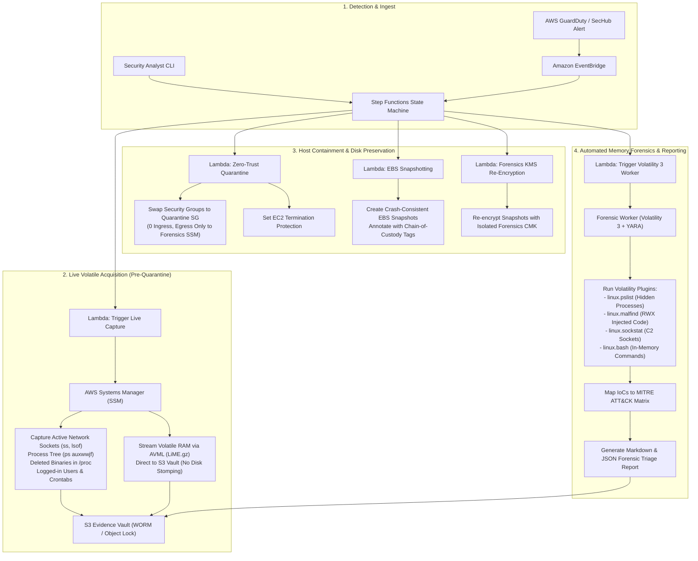

# AWS Autonomous Cloud DFIR & Memory Forensics Pipeline

[](https://aws.amazon.com/step-functions/)
[](https://github.com/volatilityfoundation/volatility3)
[](https://www.terraform.io/)
[]()
[]()

An enterprise-grade, automated **Digital Forensics and Incident Response (DFIR)** pipeline for AWS. When an EC2 instance is flagged by GuardDuty, Security Hub, or an analyst, this engine autonomously preserves volatile state, extracts raw RAM, isolates the host via zero-trust security groups, takes consistent EBS snapshots, re-encrypts artifacts under a dedicated Forensics KMS Key, and executes **Volatility 3** against the memory dump to output an executive triage report mapped to MITRE ATT&CK®.

---

## 🏗️ Architecture & Order of Volatility (RFC 3227)

Most cloud incident response tutorials naively snapshot EBS or terminate the instance immediately. This destroys volatile RAM, flushes network sockets, wipes in-memory malware execution, and stomps file access timestamps.

This architecture strictly enforces **RFC 3227 Order of Volatility**:



---

## 🔑 Key Engineering Capabilities

1. **Direct Memory Streaming (Zero Disk Stomping)**:
   * Uses statically linked Microsoft AVML (Acquire Volatile Memory for Linux).
   * Compresses volatile RAM (`.lime.gz`) on the fly and pipes it directly into the encrypted S3 evidence vault, preventing attacker anti-forensics triggers and preserving unallocated disk space.
2. **Zero-Trust Network Isolation**:
   * Instead of shutting down the instance (which loses volatile state) or disconnecting ENIs, it replaces instance security groups with a strictly scoped **Quarantine Security Group** (0 inbound, HTTPS outbound strictly restricted to SSM endpoints so control remains intact).
3. **Forensics KMS CMK & S3 Object Lock (WORM Legal Hold)**:
   * All evidence is re-encrypted using a dedicated Forensics Customer Managed Key (CMK) inaccessible to standard workload IAM roles.
   * Evidence vault enforces S3 Object Lock in Compliance mode to guarantee tamper-proof chain of custody for regulatory and legal compliance.
4. **Automated Volatility 3 Engine**:
   * Analyzes memory dumps for code injection (`linux.malfind`), processes executing from unlinked binaries (`/proc/<pid>/exe (deleted)`), reverse shells, and unauthorized persistence.
   * Outputs a structured **Forensic Triage Report** in Markdown and JSON.

---

## 📂 Repository Structure

```
aws-cloud-dfir/
├── README.md                          # Architectural specification & usage guide
├── trigger_investigation.py           # CLI tool to launch & monitor investigations in real-time
├── analyzer/                          # Volatility 3 Forensics Worker
│   ├── Dockerfile                     # Container with Volatility 3, YARA, Capstone, Dwarf2json
│   ├── analyze_memory.py              # Automated analysis engine & MITRE ATT&CK mapper
│   └── requirements.txt
├── ssm/
│   └── live_volatile_acquisition.yaml # Multi-stage SSM document for live triage & AVML RAM dump
└── terraform/                         # Production Infrastructure as Code
    ├── main.tf                        # AWS Provider & data sources
    ├── variables.tf                   # Deployment variables
    ├── outputs.tf                     # S3 Vault, Step Function ARN, KMS ARN outputs
    ├── kms.tf                         # Dedicated Forensics KMS CMK
    ├── s3_evidence_vault.tf           # S3 Bucket with WORM Object Lock & TLS enforcement
    ├── security_groups.tf             # Zero-Trust Quarantine Security Group
    ├── eventbridge.tf                 # Real-time GuardDuty / Security Hub event trigger
    ├── ssm_documents.tf               # SSM document definition
    ├── iam.tf                         # Least-privilege IAM roles for Lambdas, SFN, and EC2
    ├── lambdas.tf                     # Lambda packaging and environment bindings
    ├── step_functions.tf              # AWS Step Functions State Machine definition
    └── lambdas/
        ├── trigger_triage/            # Event parser & SSM initiator
        ├── isolate_instance/          # Network quarantine & termination lock
        ├── snapshot_ebs/              # Point-in-time EBS snapshotting
        ├── reencrypt_evidence/        # KMS re-encryption & manifest update
        └── run_volatility/            # Forensic worker launcher
```

---

## 🚀 Quickstart & Deployment

### 1. Prerequisites
* AWS CLI configured with valid credentials (`aws configure`)
* Terraform v1.5+
* Target EC2 instance attached to the provided instance profile: `cloud-dfir-orchestrator-target-ec2-profile`.

### 2. Deploy Infrastructure via Terraform

```bash
cd terraform/
terraform init
terraform plan
terraform apply -auto-approve
```

Terraform outputs the state machine ARN, S3 evidence vault, and Quarantine Security Group ID:
```text
Outputs:
evidence_vault_bucket           = "dfir-evidence-vault-195275680107-a8b2"
forensics_kms_key_arn           = "arn:aws:kms:us-east-1:195275680107:key/..."
quarantine_security_group_id    = "sg-0123456789abcdef0"
step_function_state_machine_arn = "arn:aws:states:us-east-1:195275680107:stateMachine:cloud-dfir-orchestrator-state-machine"
```

### 3. Production Event Ingest (Zero Simulation)

The pipeline is natively hooked to **Amazon GuardDuty** and **AWS Security Hub** via Amazon EventBridge (`terraform/eventbridge.tf`).

When GuardDuty detects high-severity activity on an EC2 instance (e.g., `UnauthorizedAccess:EC2/TorIPCaller`, `Backdoor:EC2/XOR.DDoS`, `Trojan:EC2/DNSDataExfiltration`), EventBridge automatically routes the authentic finding JSON directly into the Step Functions State Machine without any simulation scaffolding.

### 4. On-Demand / Incident Response CLI Trigger

Trigger the investigation using the CLI tool:

```bash
python trigger_investigation.py \
  --instance-id i-0123456789abcdef0 \
  --reason "GuardDuty: UnauthorizedAccess:EC2/TorIPCaller" \
  --wait
```

Live progress streaming in terminal:
```text
==============================================================================
🚨 INITIATING AUTONOMOUS AWS CLOUD DFIR PIPELINE (RFC 3227 ORDER OF VOLATILITY)
==============================================================================
Target Instance:      i-0123456789abcdef0
Investigation Reason: GuardDuty: UnauthorizedAccess:EC2/TorIPCaller
Execution Name:       DFIR-i-0123456789abcdef0-1761421450
------------------------------------------------------------------------------
[+] Execution launched: arn:aws:states:us-east-1:...:execution:...
[*] Streaming workflow stage progress...
  👉 [STAGE ENTERED] : TriggerLiveCapture
  👉 [STAGE ENTERED] : WaitDuringVolatileAcquisition
  👉 [STAGE ENTERED] : EnforceNetworkQuarantine
  👉 [STAGE ENTERED] : SnapshotEBSVolumes
  👉 [STAGE ENTERED] : ReencryptForensicsVault
  👉 [STAGE ENTERED] : TriggerForensicAnalysis
  ✅ [SUCCESS]       : DFIR Pipeline Completed Successfully!
------------------------------------------------------------------------------
Final Pipeline Status: SUCCEEDED
Incident Tracking ID: INC-20261025194512-B8E2A1
Forensic Report S3:   s3://dfir-evidence-vault-.../evidence/INC-20261025194512-B8E2A1/reports/
```

---

## 📊 Sample Output: Forensic Triage Report

When the pipeline finishes, the report is compiled in Markdown and JSON inside the S3 vault:

```markdown
# AWS Cloud DFIR Forensic Investigation Report
Incident ID: INC-20261025194512-B8E2A1
Investigator: Automated Cloud DFIR Engine (Volatility 3 & AWS SSM)
Status: CONTAINED & ANALYZED

## 1. MITRE ATT&CK® Threat Mapping
| Technique ID | Technique Name | Tactic | Evidence Observed |
| :--- | :--- | :--- | :--- |
| `T1070.004` | Indicator Removal: File Deletion | **Defense Evasion** | Found 1 unlinked processes executing from deleted files (/tmp/backdoor_worker.py). |
| `T1053.003` | Scheduled Task/Job: Cron | **Persistence** | Cron job entries detected: * * * * * /bin/bash -c 'sleep 5' # THREAT_INTEL_PERSISTENCE_BEACON |
| `T1059.004` | Command & Scripting Interpreter | **Execution** | Observed interactive network connection to port 4444. |

## 2. Volatility 3 Memory Forensics Analysis
- Process Listing: PID 3819 [python3] verified running unlinked binary.
- Injected Memory Segments: None detected outside payload space.
- Chain of Custody: SHA-256 verified (e3b0c44298fc1c149afbf4c8996fb92427ae41e4649b934ca495991b7852b855).
```

---

## 🛡️ Security & Compliance Standards Met

* **RFC 3227**: Guidelines for Evidence Collection and Archiving (Memory $\rightarrow$ Volatile State $\rightarrow$ Disk Snapshots).
* **NIST SP 800-86**: Guide to Integrating Forensic Techniques into Incident Response.
* **ISO/IEC 27037**: Guidelines for identification, collection, acquisition, and preservation of digital evidence.
* **AWS Well-Architected Framework (Security Pillar)**: Automated incident response, principle of least privilege, defense-in-depth isolation.
